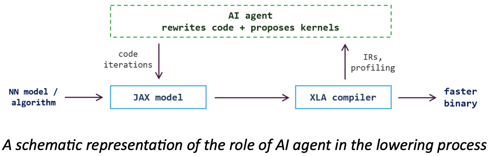

#**Agentic AI Compiler** (Ericsson Project)
## Project Description
Running large AI models is one of the dominant costs in the industry, so every percent of inference or training speedup translates directly into financial gain and larger models. This is why frontier labs invest heavily in model lowering: turning a high-level model definition into fast machine code for a specific accelerator. Today this pipeline mixes manual and automatic stages. At the top, human experts redesign algorithms with mathematical and hardware-aware tricks, such as FlashAttention. Below that, engineers hand-write and tune device kernels (in CUDA, Triton, or Pallas), which is a slow and expertise-heavy task. Compilers then lower the model’s computation graph automatically, performing operator fusion, layout assignment, and scheduling. Compiler is constrained by fixed rewrite rules: it can fuse and schedule operations, yet cannot restructure an algorithm, so on its own it never rediscovers e.g. the streaming-softmax reformulation behind FlashAttention. The kernel-writing stage is an active research area: agentic systems like Sakana AI CUDA Engineer and DeepMind’s AlphaEvolve discover kernels and low-level optimizations that beat expert-tuned baselines. The common thread is that a reasoning agent can read profiles, form hypotheses, rewrite code, and measure the result – the way a human performance engineer does – can explore optimizations that a rule-based compiler cannot.



In this project, an agentic system was built that supplements a compiler to make AI models faster. Given a model or algorithm written in JAX, the array-computation and program-transformation language used by leading AI labs, which runs the same code on different hardware. The agent works in an iterative loop around the XLA compiler: it inspects the lowered program and its runtime profile, proposes high-level rewrites of the JAX code, suggests and implements custom kernels, recompiles, and analyzes the resulting performance to decide the next step. Language models do not always know much about a given accelerator or about compiler behavior, so part of the task was to give the agent the right context and feedback signals: profiling data, compiler intermediate representations (HLO/StableHLO), and correctness checks.

**Project goals:** build an agentic optimization loop around JAX/XLA that iteratively rewrites code, proposes kernels, and profiles the result; demonstrate on a set of models/algorithms that the agent produces a measurably faster program than vanilla XLA compilation while preserving correctness; gradually grow from simple optimizations to full model rewrites.


### Project Structure

```text
Ericsson-Agentic-AI-Compiler/
│
├── README.md
├── requirements.txt
├── .gitignore
│
├── src/
│   ├── agent/
│   ├── benchmarks/
│   ├── compiler/
│   ├── profiling/
│   ├── optimization/
│   └── benchmarks/      # program registry, baseline runner, agent runner
│
└── data/
    └── programs/        # one JAX benchmark program per file
```

## Project Setup
### Setup environment
Using Python 3.14.4, setup the venv, activate and verify it
```bash
python3 -m venv .venv
source .venv/bin/activate
python --version
which python
```
The Python executable should point to the .venv directory inside the project.

Then optionally, but recommended to automatically activate the environment when entering the repository, setup direnv using this command for macOS google for other OS
```bash
brew install direnv
```

Create the .envrc 
```bash
touch .envrc
```

Open .envrc and copy-paste this line into the file
```bash
source .venv/bin/activate
```

Then paste this command into terminal
```bash
direnv allow
```

### Install requirements
```bash
pip install -r requirements.txt
```

## Pipeline

### Compiler interface

`compile_program(program, inputs: tuple) -> CompilationResult` is the shared
compilation interface used by the evaluator and compiler demo. It accepts a
pure JAX function and a tuple of positional array inputs, lowers and compiles
once per call, and returns:

| Field | Contents |
| --- | --- |
| `executable` | A compiled callable specialized to the input shapes and dtypes |
| `stablehlo` | The lowered StableHLO representation as text |
| `optimized_hlo` | The compiled HLO representation as text, or `None` when unavailable |

The wrapper uses JAX's normal specialization and device behavior. Callers own
input placement, execution, synchronization, and benchmarking. Compilation and
unexpected inspection errors propagate unchanged. Compiler text is intended
for inspection, not executable serialization; there is no custom cache.

```python
import jax
import jax.numpy as jnp

from src.compiler.compile import compile_program, simple_program

inputs = jax.block_until_ready((
    jnp.ones((32, 32), dtype=jnp.float32),
    jnp.ones((32, 32), dtype=jnp.float32),
))
compilation = compile_program(simple_program, inputs)
result = jax.block_until_ready(compilation.executable(*inputs))
```

Run the compiler demo from the repository root:

```bash
python src/compiler/compile.py
```

It prints StableHLO, optimized HLO (or an availability message), the result
shape, and execution time after warm-up. Representation text and timings vary
with the backend and software versions.

### Evaluator

The evaluator compiles both reference and candidate through `compile_program`,
then compares them on one tuple of array inputs. It owns input placement,
correctness checks, execution timing, and failure classification; compiler
representations remain in `CompilationResult`, separate from evaluation metrics.
Both functions must be pure and return a single finite
floating-point array with the same shape and dtype. Values are compared using
`atol + rtol * abs(reference)`, with defaults of `rtol=1e-5` and `atol=1e-6`.
Tolerances must be finite, nonnegative scalars; `repeats` must be a positive integer.

Pass `holdout_inputs`, a second tuple with the same shapes and dtypes, to also
check the candidate on an input case the agent never saw. A candidate that is
only right for the values of the first input is then rejected.

Pass `compile_time_limit` (seconds) to reject a candidate that takes longer to
compile. XLA cannot be stopped mid-compile, so the program is first compiled
in a child process that is killed at the limit (see
`src/compiler/compile_time_limit.py`). On the L4, XLA's autotuner took over 15
minutes to compile one short program. The agent uses a limit of 60 s by
default (`AgentConfig.compile_time_limit_seconds`).

Successful evaluations report median execution times in milliseconds and an
observed speedup. Compilation, input placement, and warm-up are excluded from
timing. The two programs are timed in turns, and the one that goes first swaps
every round: timing one program completely before the other made two identical
programs measure 1% to 3% apart. Candidate failures report a `failure_stage`
(`compile`, `execute`, `correctness`, or `benchmark`) and a readable `message`,
without timings or a speedup. The agent adds a fifth stage, `load`, for a
Gemini reply that could not be turned into a function. Invalid arguments and
reference-function errors raise exceptions.

Run the demo and tests from the repository root with the environment activated:

```bash
python -m src.optimization.demo_evaluator
python -m unittest discover -s tests -v
```

The demo uses minimal inputs. A single evaluation does not establish general
correctness or a repeatable speedup, and peak memory is not measured. Use the
target GPU for GPU performance comparisons.

### Benchmark suite

`src/benchmarks/programs.py` holds 13 small JAX programs. Each has a
`reference` (a natural way to write it) and an `expert` rewrite (the fastest
version we know). The rewrites change the algorithm, which XLA does not do by
itself. The agent is shown only the source of the reference.

The input sizes are chosen for the NVIDIA L4, so each expert takes at least
0.7 ms there (see the comment above `PROGRAMS`). A full run on a laptop CPU
is slow and needs several GB of memory.

Measure the expert speedups on the current device. This makes no LLM request:

```bash
python -m experiments.run_suite
```

Let the agent try each program. Every attempt is one Gemini request, so the
default of 3 attempts on 13 programs is 39 requests. The free tier allows 20
per model per day; use `--programs` to split a run over two days:

```bash
python -m experiments.run_suite --agent
python -m experiments.run_suite --agent --programs attention,prefix_sums
```

After each attempt the agent is shown its own code, the evaluator's verdict
(the error message or the speedup), and the best attempt so far. The final
table lists the expert speedup, the agent's best speedup, the agent's share of
the expert speedup, and the first attempt that reached 70% of it. Results are
saved to `artifacts/suite-runs/`.

## GPU setup

The GPU VM is `jax-gpu-l4` in `us-west4-a` (`g2-standard-4`, one NVIDIA L4,
driver 580). Its environment was set up with Python 3.12 and
`jax[cuda12]==0.12.0.1`. Use this one GPU model for all reported timings.

Start the VM and connect. The start can fail if the zone has no free GPUs:

```bash
gcloud compute instances start jax-gpu-l4 --zone=us-west4-a
gcloud compute ssh jax-gpu-l4 --zone=us-west4-a
```

The VM's system Python is too old for this version of JAX, so create the
environment with [uv](https://docs.astral.sh/uv/) from the repository root.
Skip this if `.venv` already exists:

```bash
uv venv --python 3.12 .venv
uv pip install --python .venv/bin/python -r requirements-gpu.txt
```

Check that JAX compiles and runs on the GPU:

```bash
.venv/bin/python -m scripts.check_gpu
```

Stop the VM when you are done, because it is billed while running:

```bash
gcloud compute instances stop jax-gpu-l4 --zone=us-west4-a
```

Below roughly 1024x1024, `simple_program` timings are about 0.14 ms at every
size because overhead dominates. Use workloads large enough that their timing
grows with input size before reporting a speedup.

### Benchmark programs

The agent is evaluated on programs modelled on KernelBench, chosen to cover
different computational characteristics. Each lives in its own file in
`data/programs/`:

| Program | Level | Characteristic | Why it is in the set |
| --- | --- | --- | --- |
| `matmul` | 1 | compute-bound | Control case: XLA calls cuBLAS, so large wins are unlikely |
| `softmax` | 1 | memory-bound reduction | Fewer passes over memory (online softmax, fused kernel) |
| `fused_gemm_gelu_layernorm` | 2 | GEMM + elementwise + reduction | Fusion beyond what XLA already does |
| `attention` | 3 | quadratic memory at long sequences | FlashAttention-style rewrite that XLA cannot find |
| `transformer_block` (optional) | 3 | full model block | Rewrites across operator boundaries |

Every program file defines `reference(*inputs)` (the pure JAX ground truth),
`numpy_reference(*inputs)` (an independent float64 version used to verify the
JAX port), `make_inputs(seed, size)` (deterministic float32 inputs), the
sizes `small` (tests/CPU), `default` and `large` (GPU), and the `RTOL`/`ATOL`
tolerances used for correctness checks. Matmul-based programs use `1e-2`
because float32 matmuls may run in TF32 on NVIDIA GPUs. To add a program,
copy an existing file; it is discovered automatically
(see `src/benchmarks/registry.py` for the full contract).

Collect vanilla-XLA baselines (run on the target GPU; baselines are only
comparable on the same device):

```bash
python -m src.benchmarks.baseline                     # all programs, default size
python -m src.benchmarks.baseline --size small        # quick check on CPU
python -m src.benchmarks.baseline --include-optional --repeats 100
```

This checks each JAX port against NumPy for several seeds, then records median
latency and spread, cold compile time, FLOPs and bytes from XLA's cost
analysis, buffer sizes, and the StableHLO/optimized HLO. Results are written
to `artifacts/baselines/<backend>_<device>_<size>_<timestamp>/` as
`summary.json` and `summary.csv`.

Run the agent on one program (Gemini if `GEMINI_API_KEY` is set, `--demo` for
the scripted policy); the program's own tolerances are used and the run is
saved to `artifacts/agent_runs/`:

```bash
python -m src.benchmarks.run_agent --program softmax --size small
```

## Contact
John Christensen - johnchristensen@outlook.com


Joel Maharena - joel.maharena@gmail.com 


Lidya Nasser -        


Sara Strandberg -   

Ericsson Superviser: Alexander Kravberg - alexander.kravberg@ericsson.com
